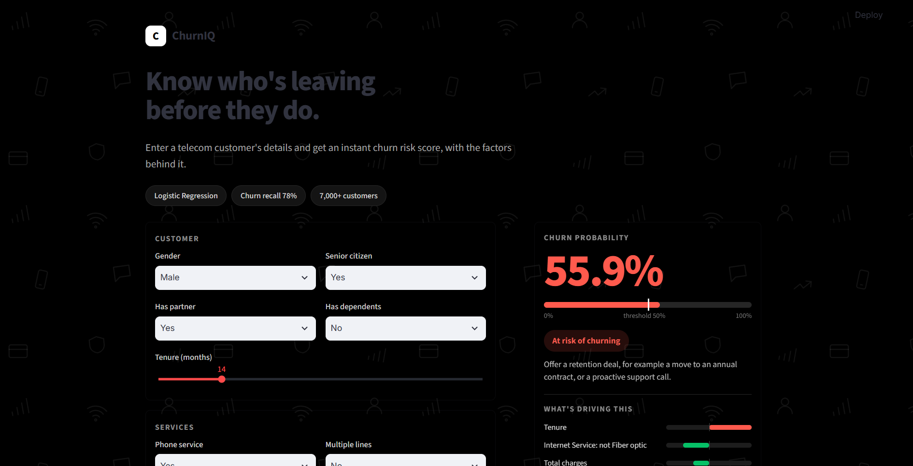

# Customer Churn Prediction & Risk Scoring App

Predicts which telecom customers are likely to leave, explains why, and lets anyone score a customer in a Streamlit app.

**Live app:** [https://telco-churn-prediction-tkxcpoi5j29ms47zqrrjfb.streamlit.app/]  |  **Notebook:** `Telco_Customer_Churn.ipynb`



## Business problem
Losing a customer costs far more than a retention offer. The goal is to flag customers at risk of churning early enough to act, and to understand what drives the risk.

## Data
IBM Telco Customer Churn dataset: 7,043 customers, 21 columns (contract, tenure, services, billing, churn flag). After removing 22 duplicate rows, 7,021 customers remained. About 27% churned.

## Approach
1. **Cleaning:** converted `TotalCharges` to numeric (11 blank values for brand-new customers set to 0), dropped `customerID`, removed duplicates, encoded `Churn` as 0/1.
2. **EDA:** churn rate by contract, tenure, internet service, add-ons, payment method and monthly charges.
3. **Modeling:** one-hot encoding, stratified 80/20 split (`random_state=42`), scaling for Logistic Regression (fit on the training set only).
4. **Evaluation:** precision, recall and F1 on the churn class, not just accuracy.
5. **Explanation:** Logistic Regression coefficients.
6. **App:** Streamlit interface that retrains the model from the CSV and scores a customer live.

## Key findings
| Segment | Churn rate |
|---|---|
| Month-to-month contract | 42.6% |
| Two-year contract | 2.8% |
| First 12 months of tenure | 47.6% |
| 60-72 months of tenure | 6.6% |
| Fiber optic internet | 41.8% |
| DSL internet | 18.9% |
| No online security | 41.6% |
| With online security | 14.6% |
| Electronic check | 45.1% |
| Other payment methods | 15-19% |

## Model comparison (churn class, test set of 1,405 customers)
| Model | Accuracy | Precision | Recall | F1 | Missed churners |
|---|---|---|---|---|---|
| Logistic Regression | 0.80 | 0.66 | 0.52 | 0.58 | 177 |
| Random Forest | 0.78 | 0.62 | 0.44 | 0.51 | 209 |
| **Logistic Regression (balanced)** | 0.74 | 0.51 | **0.78** | **0.62** | **81** |

Accuracy alone is misleading here, because about 73% of customers stay. The balanced model gives up some accuracy and precision to catch many more real churners (291 of 372), at the cost of more false alarms (283). Since a lost customer usually costs more than a retention offer, this trade-off favors the balanced model. The final model is Logistic Regression with `class_weight='balanced'`.

## What drives churn


- **Toward churn:** fiber optic internet, streaming services, electronic check payment.
- **Toward staying:** longer tenure, two-year and one-year contracts.
- `TotalCharges` and `MonthlyCharges` overlap with tenure and each other (multicollinearity), so their individual coefficients are not interpreted.

## Recommendations
1. **Focus retention on the first year.** Tenure is the strongest protective factor, so use onboarding calls and early check-ins.
2. **Move month-to-month customers to annual contracts** with a small incentive.
3. **Investigate fiber optic customers.** They carry extra risk beyond price and tenure, so look into service quality and competitor offers before choosing a fix.

These findings are associations in the data, not proven causes.

## Run locally
```bash
pip install -r requirements.txt
streamlit run app.py
```
Keep `Telco-Customer-Churn.csv` in the same folder as `app.py`. The model trains on first load (a few seconds).

## Repository contents
- `Telco_Customer_Churn.ipynb`: cleaning, EDA, modeling, explanation
- `app.py`: Streamlit app
- `.streamlit/config.toml`: dark theme settings (keep this folder next to `app.py`)
- `requirements.txt`: dependencies
- `Telco-Customer-Churn.csv`: dataset
- `images/`: screenshots used in this README

## App notes
- Total charges are estimated as tenure x monthly charges.
- The "Alert threshold" slider in the result card sets the probability above which a customer is flagged as at risk.
- The bars show each feature's contribution to that customer's score (coefficient x scaled value).

## Limitations and next steps
- One dataset from one telecom company, evaluated on a single train/test split.
- The threshold slider is manual. A next step is to choose it using the cost of a missed churner versus a retention offer.
- Next steps: cross-validation, hyperparameter tuning and SHAP explanations.
